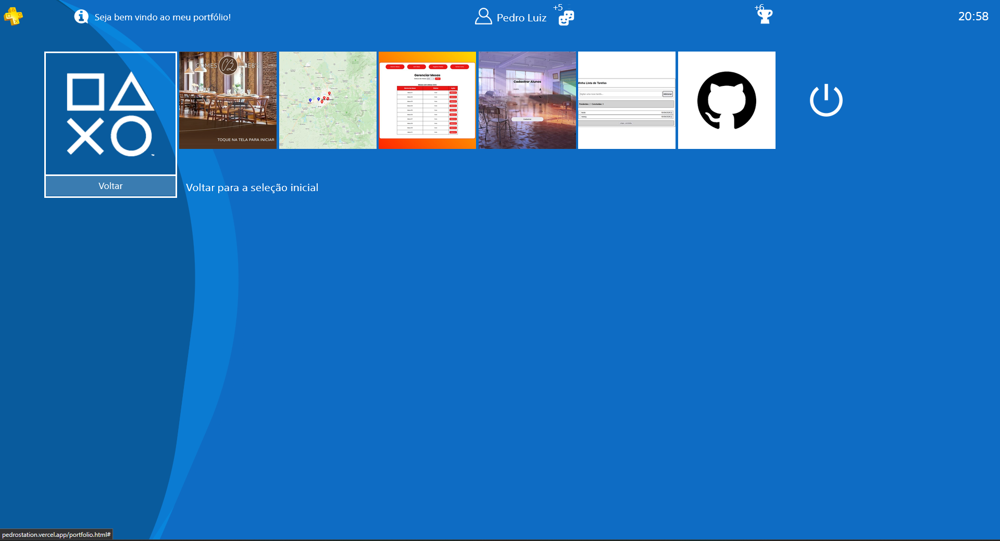

# 🎮 PedroStation 4: portfólio profissional no estilo PS4



## Descrição

**PedroStation 4** é o meu portfólio profissional, feito com a cara da interface do PlayStation 4. Em vez de um site
tradicional, o visitante "liga o console", escolhe um perfil e navega pelas telas de **Sobre mim**, **Portfólio** e
**Experiências** como se estivesse no menu do PS4, usando mouse, teclado ou controle.

O projeto foi construído a partir do template open source [Ps4-UI](https://github.com/d4v1-sudo/Ps4-UI). A base
visual do PS4 vem dele, e todo o conteúdo, as telas novas e as adaptações são meus (veja [Créditos](#créditos)).

## Telas

### 🔵 Tela inicial e seleção de perfil
- Abertura com a logo e o aviso **"Aperte Start ou Espaço"**, com o som de inicialização do console.
- Seleção de perfil no estilo do PS4, com três opções: **Sobre mim**, **Portfólio** e **Experiências**.

### 👤 Sobre mim
- Apresentação inspirada na página de um jogo da PlayStation Store: foto, cargo, localização, formação e alguns
  números de destaque.
- Área de contato inspirada na tela de mensagens do PS4, com links para GitHub e LinkedIn.
- Caixa de mensagem que monta um e-mail pronto para envio, abrindo o aplicativo de e-mail do visitante. Para quem não
  tem um aplicativo configurado, também há a opção de enviar pelo Gmail.

### 🗂️ Portfólio
- Os projetos aparecem como os jogos da tela inicial do PS4, cada um com um print do sistema.
- Ao passar o mouse (ou selecionar com teclado ou controle), aparece um balão com o resumo do projeto e as
  tecnologias usadas.
- Ao clicar, o projeto abre no GitHub.
- Ao levar o mouse para a borda da tela, a lista rola para os lados progressivamente: quanto mais perto da borda,
  mais rápido.
- Atalhos para voltar à seleção de perfil, abrir o meu GitHub e "desligar" o portfólio.

### 💼 Experiências
- Habilidades agrupadas em Front-end, Back-end e Banco de Dados.
- Histórico de experiência profissional e formação acadêmica em cartões, no estilo da tela "Communities" do PS4.

## Projetos em destaque

| Projeto | O que faz | Tecnologias |
|---|---|---|
| **Comes & Bebs** | Autoatendimento para lanchonete (TCC SENAI): totem de pedidos e pagamento, mais painel da cozinha com comandas e gestão do cardápio | PHP, MySQL, HTML, CSS, JavaScript |
| **Mapa PUC Minas** | Mapa interativo das unidades da PUC Minas, com favoritas, lista de navegação e localização do usuário | HTML, CSS, JavaScript, Mapbox GL JS |
| **Pedro Foods** | Gestão de restaurante: mesas, abertura de contas, pedidos e fechamento com 10% de serviço | PHP, MySQL, HTML, CSS |
| **Escola** | Cadastro de alunos e consulta por turma | PHP, MySQL, HTML, CSS, JavaScript, Bootstrap |
| **Lista de Tarefas** | Tarefas com contador de pendentes e concluídas e salvamento no navegador | HTML, CSS, JavaScript, LocalStorage |

## Navegação

| Ação | Teclado | Controle |
|---|---|---|
| Ligar o console / sair da tela inicial | `Espaço` ou `Enter` | `Start`, `PS` ou `✕` |
| Mover a seleção (segurar repete) | Setas ou `W` `A` `S` `D` | Direcional ou analógico esquerdo |
| Confirmar | `Enter` ou `Espaço` | `✕` |
| Voltar | `Esc` | `○` |
| Primeiro / último item do Portfólio | `Shift` esquerdo / direito | `L1` / `R1` |

O suporte a controle usa a [Gamepad API](https://developer.mozilla.org/pt-BR/docs/Web/API/Gamepad_API) do navegador e
funciona com DualShock 4, DualSense e controles de Xbox. Por segurança, o navegador só libera o controle para a
página depois do primeiro botão apertado com ela aberta.

## Tecnologias

- **HTML5** e **CSS3** puros, com animações do [Animate.css](https://animate.style/)
- **JavaScript**, com [jQuery](https://jquery.com/) na tela de Portfólio
- **Gamepad API** para navegação por controle
- [Boxicons](https://boxicons.com/) para os ícones
- **GitHub Actions** + **GitHub Pages** para o deploy automático (`.github/workflows/static.yml`)

## Estrutura

```
Portfolio-profissional/
├── index.html          # Tela inicial e seleção de perfil
├── sobre.html          # Sobre mim e contato
├── portfolio.html      # Projetos
├── experiencias.html   # Habilidades, experiência e formação
├── main.css            # Estilos das telas
└── assets/
    ├── css/            # Estilos base do template e Animate.css
    ├── font/           # Fonte no estilo do PS4
    ├── img/            # Imagens, ícones e prints dos projetos (img/projetos)
    └── js/             # Scripts de cada tela e sons do console
```

## Como rodar

Por ser um site estático, não precisa instalar nada:

1. Clone o repositório:

   ```shell
   git clone https://github.com/PedroLzAlves/Portfolio-profissional.git
   ```

2. Abra o arquivo `index.html` no navegador. Se preferir, use a extensão **Live Server** do VS Code.

A cada push na branch `master`, o GitHub Actions publica o site no GitHub Pages automaticamente.

## Créditos

Este portfólio usa como base o template **[Ps4-UI](https://github.com/d4v1-sudo/Ps4-UI)**, criado por
**Davi S. ([@d4v1-sudo](https://github.com/d4v1-sudo))**, que recria a interface do PlayStation 4 com HTML, CSS e
JavaScript puros. Agradeço ao autor por disponibilizar o projeto sob a licença MIT.

O Ps4-UI, por sua vez, se inspirou nestes trabalhos:

- Arturo Cabrera ([@Pixmy](https://www.github.com/Pixmy)): [projeto original no CodePen](https://codepen.io/Pixmy/pen/qaYQoV)
- [Kapilnemo no CodePen](https://codepen.io/Kapilnemo/pen/bwYoPZ)
- [rstacruz no CodePen](https://codepen.io/rstacruz/pen/oxJqNv)

Sobre o template, adicionei a tela inicial com seleção de perfil, as telas **Sobre mim** e **Experiências**, a
vitrine de projetos com descrições e a rolagem pela borda da tela, além de traduzir e adaptar todo o conteúdo.

## Licença

Este projeto mantém a [Licença MIT](LICENSE) do template original, incluindo o aviso de copyright de d4v1-sudo,
como a licença exige.

## Aviso

Este é um projeto pessoal, sem fins comerciais. PlayStation, PS4 e os símbolos △ ○ ✕ □ são marcas registradas da
Sony Interactive Entertainment. Este portfólio não tem qualquer vínculo com a Sony.

## Contato

- GitHub: [@PedroLzAlves](https://github.com/PedroLzAlves)
- LinkedIn: [pedroluizalves](https://www.linkedin.com/in/pedroluizalves/)
- E-mail: pedroluiz.alves06@gmail.com
